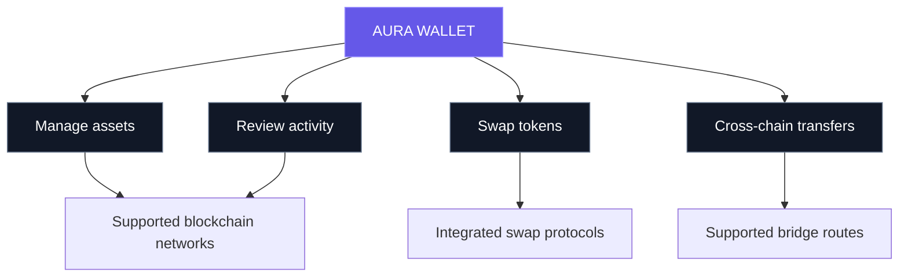
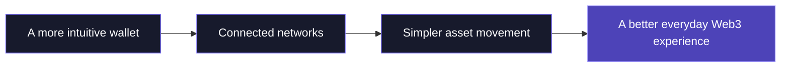

 

### Your crypto. Your keys. Your world.

**Aura Wallet is building a simpler, more connected way to experience self-custody and multichain finance.**

 

---

## ✦ About Aura

Crypto is moving across chains, protocols, and ecosystems. The wallet experience should bring it all together—not make it more complicated.

**Aura Wallet is a self-custody crypto wallet designed around control, clarity, and a modern multichain experience.** We’re working to make it easier to manage supported digital assets, explore token swaps, and move assets across supported networks from one cohesive interface.

Our goal is to make powerful Web3 tools feel approachable without losing sight of what matters most: user ownership, careful engineering, and a great product experience.

> **Our principle:** Crypto should feel connected. Control should stay with the user.

## ◈ The Aura experience

<table>
<tr>
<td width="50%" valign="top">

### 🔐 Self-custody mindset
A wallet experience centred on user ownership and control. Recovery phrases and private keys should remain private and protected.

### 🌐 Multichain access
A unified approach to supported EVM networks and other blockchain ecosystems, with coverage depending on the integrations available in the app.

### ⇄ Swaps & cross-chain routes
Explore supported token swaps and cross-chain transfer routes through integrated decentralised protocols.

</td>
<td width="50%" valign="top">

### 📊 Portfolio & activity
A clearer way to review supported assets and transaction activity across connected networks.

### ✨ Crafted interface
A modern mobile-first experience with considered visual design, smooth interactions, and a focus on usability.

### ⚙️ Evolving infrastructure
Ongoing work on reliable network connectivity, token metadata, asset delivery, and wallet functionality.

</td>
</tr>
</table>

## ⛓️ A multichain world

Aura is being developed with support for multiple blockchain ecosystems. The exact availability of features depends on the network and integration.

**The direction:** less fragmentation, more clarity, and a more cohesive way to interact with Web3.

## 🧩 Technology

Aura uses a modern cross-platform development approach and integrates with blockchain infrastructure and decentralised protocols.

| Area | Technologies / approach |
|---|---|
| Mobile application | React Native · Expo |
| Application language | TypeScript |
| Blockchain connectivity | RPC infrastructure and network-specific integrations |
| Swaps | Integrated decentralised exchange protocols |
| Cross-chain transfers | Supported bridge and routing providers |
| Token visuals and metadata | Asset delivery and token metadata infrastructure |

*This is a high-level overview, not a complete dependency inventory. Integrations and implementation details may evolve.*

## 🛡️ Security comes first

Self-custody gives users control, but it also means users must protect their wallet credentials and carefully review what they sign.

- **Never share your recovery phrase or private keys.** Aura support will never need them.
- **Verify every transaction.** Check the destination, network, token, amount, and fees before signing.
- **Be alert to impersonation.** Only use official Aura channels and verify links.
- **Understand on-chain risk.** Smart contracts, bridges, tokens, and blockchain transactions can carry risk.

Aura’s product and infrastructure continue to evolve. Do not interpret this README as a security audit, certification, or guarantee that every integration is risk-free.

## 🗺️ What we're working toward

Our priorities are to keep improving the core wallet experience, strengthen reliability, expand supported integrations carefully, and make multichain tools easier to understand and use.

## 🤝 Connect with Aura

Questions, feedback, or partnership enquiries? Reach out through the official channels below.

For support requests, **never send passwords, recovery phrases, private keys, or other sensitive wallet information.**

---

### AURA WALLET

**The Crypto Wallet. You Actually Own.**

*Building a more connected Web3 experience.*

© Aura Wallet. All rights reserved to their respective owners.

